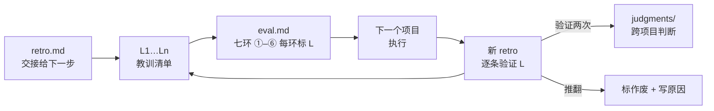

<div align="center">

# project-next-step

**复盘回答「过去哪里对、哪里错」，它回答「下一个项目因此该怎么做」。**

一个 Claude Code / Codex skill：把 [project-retro](https://github.com/imQiwei/project-retro) 写出的复盘编成 L 编号教训，<br>
注入下一个项目的开工评估，收尾时再回头验证每条教训到底有没有生效。


</div>

---

## 它解决什么

复盘最常见的结局：写完、存档、再也不打开。下一个项目照旧踩坑。

project-next-step 把教训变成可追踪的对象：

| 环节 | 做法 |
|---|---|
| 编号 | 教训统一编成 L1…Ln，只在 eval.md 开头存一份，其他地方只引用编号 |
| 注入 | 开工评估的七环 ①–⑥ 每一环都标出「用 L…」；没用上的要写为什么不适用 |
| 迁移检查 | 先看数据、组织、基建、市场变没变；新场景第一轮只验证「能不能迁移」，不叠新变量 |
| 回头验证 | 下一个项目收尾时逐条标「验证 / 推翻 / 未知」，两个项目都验证过的升为跨项目判断条目 |

## 闭环



## 五步流程

| 步 | 做什么 |
|---|---|
| 第 0 步 | 确认输入：先读 retro 末尾「交接给下一步」节，本人口径一律沿用 |
| 第 1 步 | 抽 5–10 条教训，写清出处、证据、适用条件；单次证据标「待验证」 |
| 第 2 步 | （可选）重构线：标明反事实的「如果从第一天起由我负责该怎么排」，只用于规划，不改写历史 |
| 第 3 步 | 按七环写 eval.md；不确定的汇总成待确认清单，不替本人编目标值 |
| 第 4 步 | 收尾回头验证：教训生效了吗、有没有漏用、要升级还是作废 |

## 里面有什么

| 文件 | 用途 |
|---|---|
| [`SKILL.md`](SKILL.md) | 全部流程（第 0–4 步）和 eval.md 的固定写法 |
| [`examples/eval_example.md`](examples/eval_example.md) | 虚构项目的开工评估示范，接 project-retro 的复盘示例 |

## 安装

需要和 [project-retro](https://github.com/imQiwei/project-retro) 一起装：七环、判疏漏、证据分级等规则，以及开工评估 prompt，都在 project-retro 里。

**Claude Code**

```bash
git clone https://github.com/imQiwei/project-retro.git ~/.claude/skills/project-retro
git clone https://github.com/imQiwei/project-next-step.git ~/.claude/skills/project-next-step
```

之后说「这个复盘怎么用到下一步」「按复盘写开工评估」就会自动触发，也可以用 `/project-next-step` 手动调用。

**Codex**

```bash
git clone https://github.com/imQiwei/project-retro.git ~/.codex/skills/project-retro
git clone https://github.com/imQiwei/project-next-step.git ~/.codex/skills/project-next-step
```

**其他工具**：把 `SKILL.md` 当成 prompt 直接粘贴。

## 使用前

1. 把 `<PLAYBOOK>` 换成和 project-retro 相同的复盘目录。
2. 来源复盘最好已定稿，并在末尾写了「交接给下一步」节（project-retro 第 5 步）。

试行版，流程还没被下一个项目的结果验证过；每用一次，在 `SKILL.md` 末尾的迭代记录追加一行。skill 用中文编写。示例里的项目、数字均为虚构。

同系列 skills：[project-retro](https://github.com/imQiwei/project-retro) · [data-task-spec](https://github.com/imQiwei/data-task-spec) · [retention-funnel-analysis](https://github.com/imQiwei/retention-funnel-analysis) · [data-report-html](https://github.com/imQiwei/data-report-html) · [briefing-script](https://github.com/imQiwei/briefing-script)
